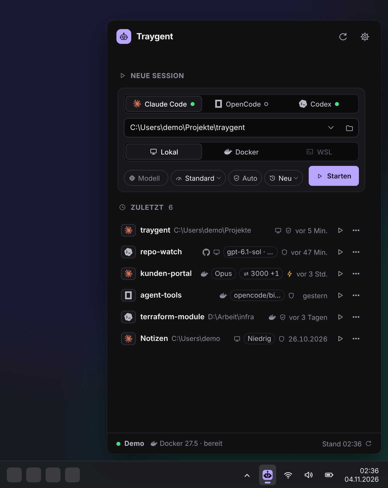
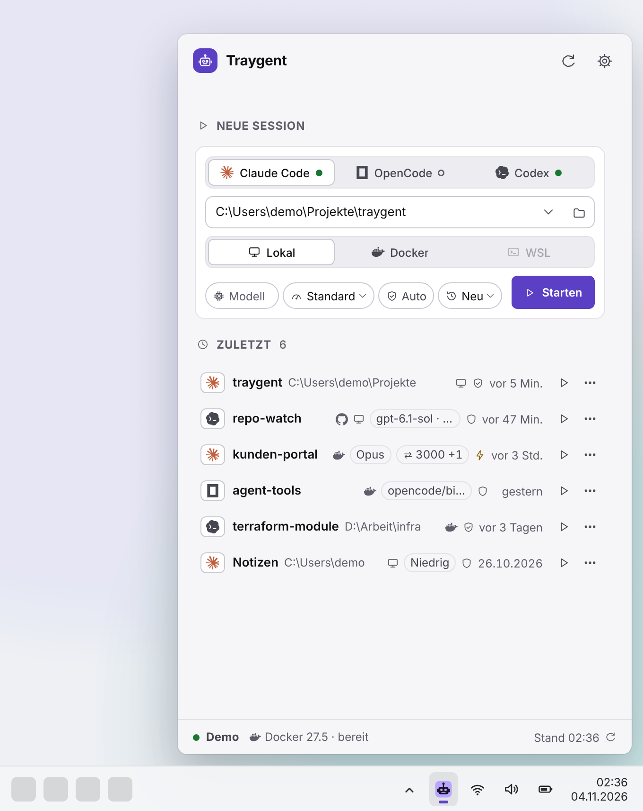

<div align="center">


# Traygent

**Coding agents within reach.**<br />
Start Claude Code, OpenCode or Codex from your Windows tray — in one click, locally or in Docker.

[](https://github.com/fo0/traygent/actions/workflows/desktop-release.yml)
[](LICENSE)


[Download](https://github.com/fo0/traygent/releases) · [Try the demo](#try-it-in-the-browser) · [User guide](docs/USAGE.md) · [Docs](#documentation)

</div>

| Dark                                                                                                                                              | Light                                                                                                                                               |
| ------------------------------------------------------------------------------------------------------------------------------------------------- | --------------------------------------------------------------------------------------------------------------------------------------------------- |
|  |  |

<sub>Browser demo with synthetic data on an illustrative taskbar. The UI is in German.</sub>

## Why Traygent

Starting a coding agent usually means: open a terminal, `cd` into the project, remember the right flags, maybe spin up a container. Traygent turns that into **pick → Enter**:

1. Click the tray icon.
2. Pick an agent and a folder — or paste a GitHub repository.
3. Press **Enter**. The session opens in Windows Terminal or a console window.

Every start lands in **Workspaces**, so the next one is a single click.

## Features

| Feature                               | What you get                                                                                                                                                       |
| ------------------------------------- | ------------------------------------------------------------------------------------------------------------------------------------------------------------------ |
| ⚡ **One-click starts**               | Agent, folder, environment, Enter. Model, effort and permission default to your settings; the session mode starts at **Neu**.                                      |
| **Subscription quotas**               | See the used quota and weekly reset beside the selected CLI, for up to three of its profiles. Opt-in per agent: off for Claude Code and Codex, on for OpenCode Go. |
| 🕘 **Workspaces**                     | Up to 20 folder · agent · environment rows; a click restarts one as it was, or lets the agent keep its own model and effort.                                       |
| 🐳 **Local or Docker**                | Run the agent on the host or in a container with shared host sign-in for Claude Code and Codex, plus optional port publishing.                                     |
| 🐙 **Start from a GitHub repository** | Paste a URL, type `owner/name` or search your repositories; Traygent clones it on first use and reuses the folder afterwards.                                      |
| 👥 **Several Claude accounts**        | One profile per sign-in; skills, plugins, settings, MCP servers and history stay the same in all of them, synced in the background every 15 minutes too.           |
| 🔍 **Detects what is installed**      | Agent CLIs, their versions and Docker are detected; a missing CLI offers its install command instead of a dead start.                                              |
| 🔄 **Updates in the app**             | Check, read the changelog and install without leaving the app.                                                                                                     |
| 🌗 **Small and native**               | Rust + Tauri, light and dark theme, starts with Windows if you want it to.                                                                                         |

Every control is described in the [user guide](docs/USAGE.md).

## Supported agents

| Agent       | Install (opens in a terminal from **Einstellungen → Agenten**) | Permission modes    | Sessions              |
| ----------- | -------------------------------------------------------------- | ------------------- | --------------------- |
| Claude Code | `irm https://claude.ai/install.ps1 \| iex`                     | Ask · Auto · Bypass | New · Continue · Pick |
| OpenCode V2 | `npm install -g @opencode/cli@latest`                          | Ask · Auto · YOLO   | New · Continue        |
| Codex       | `irm https://chatgpt.com/codex/install.ps1 \| iex`             | Ask · Auto · YOLO   | New · Continue · Pick |

How each mode maps to the CLI's own flags: [user guide → Supported agents in detail](docs/USAGE.md#supported-agents-in-detail) and [agent recipes](docs/AGENT_RECIPES.md).

## Get started

### Install

1. Download `Traygent_<version>_x64-setup.exe` from the [Releases page](https://github.com/fo0/traygent/releases).
2. Run it. The installer is **unsigned**, so Windows SmartScreen may ask once: **More info → Run anyway** (German Windows: **Weitere Informationen → Trotzdem ausführen**).
3. Traygent appears in the tray. Later updates install from inside the app.

**Requirements:** Windows x64, Windows PowerShell 5.1 (built in), an agent CLI for local starts (Traygent can install it; Docker sessions install their own). Optional: Windows Terminal, Docker (e.g. Docker Desktop), Git (for GitHub repositories).

### Try it in the browser

No Windows needed — the browser demo runs the real panel with simulated data and never starts a process:

```sh
pnpm install --frozen-lockfile
pnpm dev
```

Open http://127.0.0.1:1420. The preview is labelled **Demo**.

## Privacy and security

Where the GitHub token, profiles and local state live, what reaches the network and what stays out of a container: [user guide → Privacy and security](docs/USAGE.md#privacy-and-security).

## Limits

Windows only, German UI, one GitHub.com account, PATH after a fresh install and what is not built yet: [user guide → Limits](docs/USAGE.md#limits).

## Development

Built with **Tauri 2, Rust, Svelte 5 and TypeScript**. Prerequisites: **Node.js 24** (`.node-version`), **pnpm 11.19.0** (`packageManager`), a stable **Rust** toolchain and the [Tauri prerequisites](https://v2.tauri.app/start/prerequisites/) (on Windows: Microsoft C++ Build Tools, the MSVC Rust toolchain, WebView2).

```sh
pnpm install --frozen-lockfile
pnpm desktop:dev       # run the desktop app
pnpm verify            # lint, typecheck, tests, build
pnpm test:e2e          # Playwright against the browser demo
cargo test --locked --manifest-path src-tauri/Cargo.toml --features updates   # Rust tests
pnpm build:installer   # unsigned NSIS installer (Windows) → src-tauri/target/release/bundle/nsis/
```

No environment variables or `.env` file are needed to build, run or test; optional build-time and test variables (for example `PLAYWRIGHT_CHROMIUM_EXECUTABLE`, `POWERSHELL_EXECUTABLE`) are listed in [agent_docs/env-vars.md](agent_docs/env-vars.md).

[CI](.github/workflows/ci.yml) runs on pull requests: lint, typecheck, unit and release-helper tests, the frontend build, Playwright, and — when their files change — Rust fmt/Clippy/tests and a Windows job that builds the desktop shell and runs the Win32 popup and isolated autostart-registry tests. [Desktop Release](.github/workflows/desktop-release.yml) is started by hand on `main`, runs CI for that commit and publishes an unsigned Windows EXE ([release process](docs/RELEASES.md)). README screenshots: `pnpm capture:readme`.

## Documentation

| Topic                                                                                           | For                                          |
| ----------------------------------------------------------------------------------------------- | -------------------------------------------- |
| [User guide](docs/USAGE.md)                                                                     | every control, GitHub repositories, Docker   |
| [Specification](docs/SPEC.md)                                                                   | product, IPC contract, launch rules          |
| [Agent recipes](docs/AGENT_RECIPES.md)                                                          | per-agent flags, install paths, Docker setup |
| [Architecture](docs/ARCHITECTURE.md) · [diagram](docs/ARCHITECTURE.mmd) · [decisions](docs/adr) | how it is built and why                      |
| [Releases and updates](docs/RELEASES.md) · [verification](docs/VALIDATION.md)                   | shipping and testing                         |
| [Windows autostart](docs/WINDOWS_AUTOSTART.md) · [popup](docs/WINDOWS_POPUP_VALIDATION.md)      | Windows integration details                  |
| [Asset sources](docs/ASSETS.md)                                                                 | icon and image provenance                    |

## License

[MIT](LICENSE). Dependencies retain their own licenses. Icons and UI glyphs are drawn from repository-native geometry ([asset sources](docs/ASSETS.md)). The app shell derives from [RepoWatch](https://github.com/fo0/repo-watch); Traygent replaces the Batch starters of agent-tools for everyday starts.
